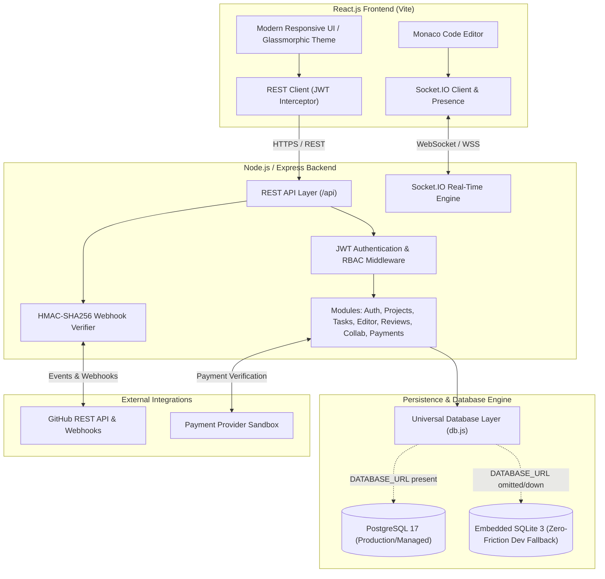

# DevCollab — Collaborative Development & Networking Platform
**Computer Engineering Major Project — Implementation Reference**  
*Version 1.0 — Architecture, Execution Guide & Verification Report*

---

## 📌 Executive Overview
**DevCollab** is a full-stack collaborative engineering platform designed to resolve workflow fragmentation across software development teams. It unifies:
1. **Developer Networking & Identity** (skills profiles, portfolio showcase, connection requests).
2. **Project & Sprint Workspace** (public/private repositories, role-based access control, task Kanban boards).
3. **Real-Time Collaborative Code Editor** (powered by Monaco Editor and Socket.IO real-time synchronization with active peer presence).
4. **Structured Code Review & Suggestions** (line-level review comments, diff-style replacement suggestions, review approvals).
5. **GitHub Repository & Webhook Delivery Engine** (cryptographic HMAC-SHA256 signature verification, delivery deduplication, simulated event pipeline).
6. **Collaboration Agreements & Payment Sandbox** (free open-source agreements and milestone compensation tracking with verified provider transactions).
7. **Real-Time Notification & Audit System** (in-app alerts, socket room broadcasts, security audit logs).

---

## 🏗️ System Architecture



---

## 🚀 Quick Start Guide

### Prerequisites
- **Node.js** v18+ (tested on Node v24.11 LTS)
- **npm** v9+ (tested on npm 11.6)
- Optional: **PostgreSQL** (if you wish to connect directly to PostgreSQL, set `DATABASE_URL` in `server/.env`; if omitted or PostgreSQL is not running, DevCollab automatically initializes the embedded zero-friction SQLite engine).

### 1. Installation
All dependencies for the root, server, and client are pre-configured:
```bash
# If running fresh from cloned repo:
npm install
cd server && npm install && cd ..
cd client && npm install && cd ..
```

### 2. Seed Database with Rich Demo Data
Populates realistic users, projects, tasks, reviews, files, and transactions:
```bash
npm run seed
```

### 3. Run Development Server (Frontend + Backend)
Runs the Express backend (`http://localhost:5000`) and the Vite React frontend (`http://localhost:5173`) concurrently:
```bash
npm run dev
```
Open **[http://localhost:5173](http://localhost:5173)** in your browser!

---

## 👥 User Accounts & Authentication Architecture
DevCollab features full production-grade developer authentication conforming to SRS FR-01, FR-02, FR-03, FR-20, and NFR-01:
- **Email & Password Authentication**: Salted `bcrypt` hashing (10 salt rounds), strict RFC email regex verification, and password strength checks (min 8 characters, letters and numbers required).
- **GitHub OAuth 2.0 Integration**: Sign in with GitHub using OAuth authorization, token exchange, and automatic developer profile linking. Works with live GitHub OAuth apps or instant local sandbox authorization.
- **Account Security & Password Recovery**: Change password with current password verification, forgot password token generation, and account audit logs.
- **User Navigation & Personas**: Clean interactive user menu with role badges and easy test persona switching for academic grading and demo reviews:

| Email | Password | Role | Description |
| :--- | :--- | :--- | :--- |
| `alex@example.com` | `password123` | **Project Owner** | Full-stack Architect, creator of DevCollab Core Suite |
| `priya@example.com` | `password123` | **Contributor** | Frontend & UI/UX Specialist, contributor on projects |
| `marcus@example.com` | `password123` | **Backend Engineer** | Cloud & Systems Developer |
| `elena@example.com` | `password123` | **Reviewer** | Security Researcher & Code Reviewer |

---

## 🧪 Acceptance Test Suite (SRS Section 11)
The project includes a comprehensive automated test suite verifying SRS Acceptance Criteria:
```bash
npm test
```

### Test Results Breakdown:
- **AT-01: Register with valid details and reject duplicates/invalid fields** (FR-01, FR-02, FR-03) `✓ PASS`
- **AT-01b: Enforce password strength, email validation, and test change password** (NFR-01, FR-03) `✓ PASS`
- **AT-01c: GitHub OAuth status and sandbox flow** (FR-20) `✓ PASS`
- **AT-02: Non-member cannot access private project** (FR-05, BR-02, NFR-03) `✓ PASS`
- **AT-03: Send and accept connection request with integrity checks** (FR-06, FR-07, FR-08) `✓ PASS`
- **AT-04: Create project and manage member roles (RBAC)** (FR-10, FR-13, FR-14) `✓ PASS`
- **AT-05: Link GitHub repository to project** (FR-16, FR-17) `✓ PASS`
- **AT-06: Process idempotent GitHub webhook simulation** (FR-18, FR-19, NFR-07) `✓ PASS`
- **AT-07 & AT-13: Collaborative editor documents and viewer edit restrictions** (FR-21, FR-24, FR-25, BR-06) `✓ PASS`
- **AT-09: Submit code review and line suggestion** (FR-26, FR-27, FR-28, FR-29, BR-07) `✓ PASS`
- **AT-10: Free collaboration agreement requires no payment** (FR-30, BR-10) `✓ PASS`
- **AT-11: Paid collaboration offer and verified sandbox settlement** (FR-31, FR-32, FR-34, BR-09) `✓ PASS`
- **AT-12: In-app notifications delivered and updated** (FR-36, FR-37, FR-38) `✓ PASS`

---

## 📁 Project Structure

```
Bharat Project/
├── docs/
│   └── SRS.md                       # Complete Software Requirements Specification
├── server/
│   ├── src/
│   │   ├── config/
│   │   │   ├── db.js                # Dual-mode DB Engine (PostgreSQL + SQLite)
│   │   │   └── env.js               # Environment variables
│   │   ├── middleware/
│   │   │   ├── auth.js              # JWT & RBAC project role middleware
│   │   │   ├── errorHandler.js      # Standardized JSON error response handler
│   │   │   └── validation.js        # Input validation helpers
│   │   ├── modules/
│   │   │   ├── auth/                # Register, login, session inspection
│   │   │   ├── users/               # Profiles, skills, discovery
│   │   │   ├── connections/         # Developer networking & connection requests
│   │   │   ├── projects/            # Project CRUD, discovery, feed, membership
│   │   │   ├── tasks/               # Kanban task tracking & assignment
│   │   │   ├── github/              # Repo metadata, HMAC webhooks, simulation
│   │   │   ├── editor/              # Document persistence & access verification
│   │   │   ├── reviews/             # Code review threads & inline suggestions
│   │   │   ├── collaborations/      # Free & paid collaboration agreements
│   │   │   ├── payments/            # Provider sandbox payment settlement
│   │   │   ├── notifications/       # Notification delivery & status
│   │   │   └── audit/               # Security audit trail logging
│   │   ├── realtime/
│   │   │   └── socket.js            # Socket.IO presence & real-time editor sync
│   │   ├── db/
│   │   │   ├── schema.sql           # Full PostgreSQL DDL schema
│   │   │   └── seed.js              # Rich database seed data
│   │   ├── app.js                   # Express application setup
│   │   └── server.js                # Server entrypoint with Socket.IO
│   ├── test/
│   │   └── api.test.js              # Automated acceptance test suite
│   ├── .env.example
│   └── package.json
├── client/
│   ├── src/
│   │   ├── components/
│   │   │   ├── Navbar.jsx           # Global header with 1-click demo switcher
│   │   │   ├── NotificationMenu.jsx # Real-time alerts dropdown
│   │   │   ├── Modal.jsx            # Accessible overlay modal
│   │   │   └── Badge.jsx            # Status badge components
│   │   ├── features/
│   │   │   ├── auth/                # Login, register, quick switch
│   │   │   ├── projects/            # Discovery, detail view, tabs
│   │   │   ├── editor/              # Monaco collaborative editor & presence
│   │   │   ├── tasks/               # Kanban task board
│   │   │   ├── reviews/             # Code review & inline suggestions
│   │   │   ├── github/              # Linked repository & webhook events
│   │   │   ├── collaboration/       # Milestone agreements & payment settlement
│   │   │   ├── network/             # Developer directory & connections
│   │   │   ├── feed/                # Live platform activity feed
│   │   │   └── profile/             # Profile management & portfolio showcase
│   │   ├── services/
│   │   │   ├── api.js               # REST client with JWT handling
│   │   │   └── socket.js            # Real-time WebSocket connection
│   │   ├── App.jsx                  # Main view manager
│   │   ├── main.jsx                 # Vite application mount
│   │   └── index.css                # Dark developer UI design system
│   ├── package.json
│   └── vite.config.js
├── SRS.md                           # Baseline SRS Specification
├── package.json                     # Monorepo scripts
└── README.md                        # Documentation & setup guide
```

---

## 🔒 Security & Quality Attributes (NFR Traceability)

- **Password Hashing (NFR-01)**: Salted `bcrypt` hashing with salt rounds of 10. Plaintext passwords never reach storage.
- **Server-Side Authorization (NFR-02, BR-02)**: Access control is strictly enforced on the server for all REST endpoints, Socket.IO rooms, and document sessions. Viewers are blocked from editing.
- **Privacy & Visibility (NFR-03)**: Non-members cannot view private project details, documents, or repository activity.
- **Webhook Idempotency (NFR-07, FR-19)**: GitHub webhook deliveries verify `X-Hub-Signature-256` and deduplicate `X-GitHub-Delivery` IDs to prevent replay attacks.
- **Payment Verification (FR-34, BR-09)**: Payment statuses are updated solely via verified server-side transactions; browser-only claims are rejected.
- **Standardized Error Handling (FR-42)**: API returns uniform `{ "error": { "code": "...", "message": "..." } }` responses with server correlation IDs on internal errors, without leaking stack traces or credentials.

---

## 🎓 Academic Demonstration Guide

When evaluating or presenting DevCollab:
1. **Multi-User Collaboration**: Open two browser windows (e.g., standard window and incognito window). Log in as **Alex (Owner)** in one window and **Priya (Contributor)** in the other via the 1-click demo switcher.
2. **Real-Time Code Editing**: Navigate to `DevCollab Core Suite` -> `Code Editor`. Open `src/syncEngine.js` in both windows. Notice active presence pills displaying who is currently editing. Types made in one window synchronize to the other without manual page reload!
3. **Role Enforcement**: Switch Priya's role to `Viewer` in the Members tab. The editor in her window immediately switches to read-only with a protective warning badge, rejecting any edit attempts with `403 Forbidden`.
4. **GitHub Webhook Verification**: Navigate to the `GitHub & Webhooks` tab. Click `Simulate Webhook Event`. Observe cryptographic delivery deduplication, event logging, and real-time notification dispatch to all project members.
5. **Code Review Suggestions**: In `Code Reviews`, inspect the review thread, add an inline correction, and approve the review decision.
6. **Milestone Compensation**: In `Agreements & Ledger`, view the collaboration offer terms and trigger `Settle Sandbox Payment` to observe verifiable provider settlement.
